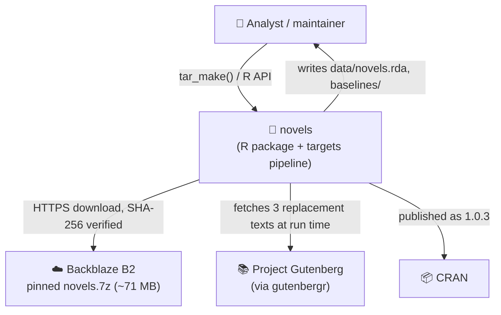
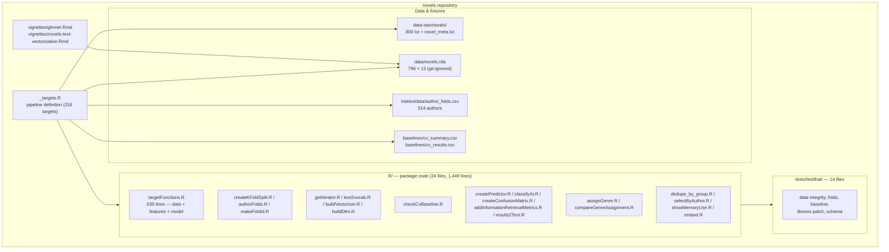
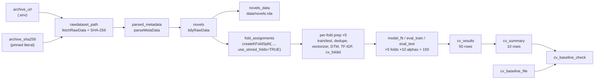
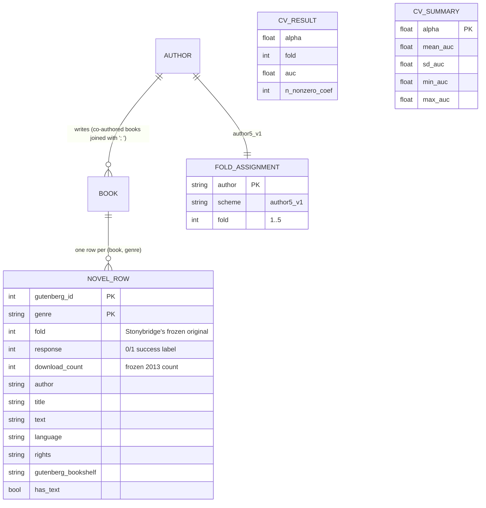

# Phase 1 — Discovery: `novels`

> **Historical.** This records the 2026-11-06 architecture revision and is not
> maintained. Current documentation starts at [README § Documents](../README.md#documents).

**Date:** 2026-11-06
**Scope:** whole repository, with emphasis on `README.md`, `TODO.md`, `_targets.R`
**Method:** read every tracked source file, the pipeline definition, tests, vignettes, and the
recorded baselines; ran the test suite and probed the two newest mechanisms directly.

> This document records **what is**, not what should be. Judgements are deferred to
> `phase-2-diagnosis.md`; the "smells" list at the end is raw observation.

---

## 1. System overview

`novels` is an R package *and* a `targets` pipeline. Its job is to reproduce and extend the
dataset and classifier from Ashok, Feng & Choi (2013), *Success with Style*: predict whether a
Project Gutenberg novel is "successful" from its writing style, using a TF-IDF + elastic-net
classifier scored by AUC under author-disjoint cross-validation.

There are two distinct products in one repository:

1. **The dataset** — a pinned 7z corpus, parsed, cleaned, corrected, and shipped as
   `data/novels.rda` (796 rows over 754 books, 13 columns).
2. **The experiment** — a 10-point `alpha` sweep × 5 author-safe folds, producing 50 held-out
   AUCs and a per-`alpha` summary, checked against a recorded baseline.

The package is published on CRAN as version 1.0.3; the current working tree is the unreleased
1.1 "source-integrity fix" described in `CHANGELOG.md`.

### Technology stack

| Layer | Choice |
|---|---|
| Language | R 4.6.1 (package declares `Depends: R (>= 4.1.0)`) |
| Pipeline | `targets` + `tarchetypes` |
| Text features | `text2vec` (`itoken`, vocabulary, DTM, TF-IDF), `tm` stopwords |
| Model | `glmnet` (`cv.glmnet`, binomial, elastic net) |
| Metrics | `pROC` (AUC) |
| Data acquisition | `archive` (7z), `httr2`/`digest` (verification), `gutenbergr` |
| Docs | roxygen2 8.1.1, knitr/rmarkdown vignettes, kableExtra |
| Tests | testthat (3rd edition conventions, `tests/testthat/`) |
| Distribution | CRAN package (`DESCRIPTION` 1.0.3) + git-tracked baselines |

---

## 2. C4 context



The archive location is configuration (`NOVELS_ARCHIVE_URL` in `.env`); its SHA-256 is a literal
in `_targets.R` (`archive_sha256`). Gutenberg is a *second, unpinned* input: three LibriVox-
contaminated books are re-downloaded on every clean pipeline run (see §7).

---

## 3. Container / component view



### Module responsibilities (actual, as written)

| File(s) | Responsibility | Notes |
|---|---|---|
| `R/targetFunctions.R` | 5 concerns in one file: archive fetch + SHA verify; metadata parsing; corpus tidying + LibriVox patching + boilerplate stripping; DTM/TF-IDF; glmnet fit/eval | 630 lines, 16 functions, 3 named constants |
| `R/createKFoldSplit.R`, `authorFolds.R`, `makeFoldid.R` | Author-grouped outer folds (stored or generated) and inner CV folds | `assignAuthorFolds` and `makeFoldid` duplicate the same seed/sample logic |
| `R/getIterator.R`, `text2vocab.R`, `buildVectorizer.R`, `buildDtm.R` | Tokenisation → vocabulary → vectorizer → DTM | Deliberately split so vocabulary and DTM share one tokeniser |
| `R/fitTfidf` / `transformTfidf` (in `targetFunctions.R`) | Fit TF-IDF on train, transform test with the fitted model | Returns the fitted model so it is a tracked target |
| `R/checkCvBaseline.R` | Compare a run's `cv_summary` to `baselines/cv_summary.csv`; warn beyond 2 SE | Called from `_targets.R`; see finding F2 |
| `R/createPredictor.R`, `classifyAt.R`, `createConfusionMatrix.R`, `addInformationRetrievalMetrics.R`, `results2Text.R` | Scoring closure + thresholding + IR metrics | Used by the glmnet vignette, not by the pipeline |
| `R/assignGenre.R`, `compareGenreAssignment.R` | Bookshelf → genre allow-list mapping and calibration against Stonybridge labels | Exported, but **not used by the pipeline**; allow-list file lives only in `tmp/` |
| `R/embed.R` | Ollama `/api/embed` call | 5 lines, undocumented, unexported, unused, hard-coded host |
| `R/dedupe_by_group.R`, `selectByAuthor.R`, `showMemoryUse.R` | Small utilities | `showMemoryUse` is a legacy debugging helper |
| `R/data.R`, `globals.R`, `novels_package.R` | Dataset docs, NSE globals, import declarations | |

---

## 4. The pipeline (`_targets.R`) — 216 targets

The pipeline is built with base-R metaprogramming (`bquote`/`as.call`/`tar_target_raw`), not
`tar_map()`. The README calls this "Lispy cool but difficult to debug" (TODO refactoring item).



Target accounting (from `tar_manifest()`): **216**, not the 213 the README states.

| Block | Count |
|---|---|
| Base data targets | 7 |
| Per-fold prep (11 × 5) | 55 |
| Per-(fold, alpha) fit/eval (3 × 50) | 150 |
| Summaries + baseline check | 4 |
| **Total** | **216** |

`tar_option_set(packages = ...)` lists `usethis` and `assertthat`, neither of which is used
anywhere in `R/` or `_targets.R`; both are absent from `DESCRIPTION`.

---

## 5. Data model

`novels` is a single flat table, but three relationships are load-bearing and are easy to get
wrong (the README spends a section on their grain):



**Grain census** (README §"Grain of the corpus", all independently re-derived here):

| Grain | Count |
|---|---|
| files in the archive tree | 800 |
| distinct Gutenberg IDs on disk | 758 |
| metadata blocks | 799 |
| parseable records | 798 |
| rows in `novels` | 796 |
| distinct books in `novels` | 754 |
| multi-genre books | 41 (42 extra rows) |
| authors | 514 |
| stored fold rows | 514 |

The shipped `novels` schema (13 columns) is locked by `test-novels-schema.R`:
`text, gutenberg_id, genre, fold, author, gutenberg_author_id, response, download_count, title,
language, rights, gutenberg_bookshelf, has_text`.

`fold`, `download_count`, and `response` are deliberately **frozen** as Stonybrook's originals;
anything new goes in separate tables (TODO "Done", decided 2026-10-30).

---

## 6. Key flows

### Flow A — building the dataset (`tar_make()`)

```mermaid
sequenceDiagram
    participant T as targets
    participant F as fetchRawData
    participant P as parseMetaData
    participant D as tidyRawData
    participant G as gutenbergr
    participant W as writeNovelsData

    T->>F: archive_url, archive_sha256
    F->>F: download 7z (only if data-raw/novels absent)
    F->>F: verify_sha256 → abort on mismatch
    F->>F: archive_extract → data-raw/novels/
    T->>P: parseMetaData(rawdataset_path)
    P->>P: drop truncated record, fill genre/fold,<br/>assert 8 datasets + 40 folds,<br/>file-conservation assert
    T->>D: tidyRawData(rawdataset_path, parsed_metadata)
    D->>D: list files → one row per book
    D->>D: join gutenberg_metadata; collapse co-authors
    D->>G: gutenberg_download(18857, 76, 3477)
    G-->>D: replacement text (lowercased)
    D->>D: drop 19678/19782, patch 3, assert no "librivox"
    D->>D: stripGutenbergBoilerplate on every book
    D->>D: join metadata; assert row count and no NA counts
    T->>W: writeNovelsData(novels) → data/novels.rda
```

### Flow B — the cross-validation sweep

```mermaid
sequenceDiagram
    participant T as targets
    participant S as createKFoldSplit
    participant V as buildVectorizer/buildDtm
    participant M as cv.glmnet
    participant E as evaluateModel

    T->>S: novels, k=5, use_stored_folds=TRUE
    S-->>T: 5 × {train, test} row indices
    loop each fold k
        T->>V: vectorizer(train_k) → DTM(train_k), DTM(test_k)
        T->>V: fitTfidf(train DTM); transform(test DTM)
        T->>T: makeFoldid(train_k$author) — shared across alphas
    end
    loop each (fold, alpha)
        T->>M: cv.glmnet(dtm_train, response, alpha, foldid, type.measure="auc")
        T->>E: predict(test), AUC, count nonzero
    end
    T->>T: bind 50 eval_test rows → cv_results → cv_summary → checkCvBaseline
```

### Flow C — scoring new books (vignette / API)

`createPredictor(vectorizer, tfidf, model)` returns a closure. The closure tokenises the new
texts with the *same* iterator, builds a DTM, transforms it with the already-fitted TF-IDF model,
predicts probabilities, and adds `probability`/`score`. `classifyAt(scored, threshold)` then
adds a 0/1 `prediction` without re-running the model. This separation (score vs. threshold) is
deliberate and documented.

---

## 7. External dependencies and inputs

| Dependency | Purpose | Criticality | Pinned? |
|---|---|---|---|
| Backblaze B2 `novels.7z` | the corpus | required | **yes** — SHA-256 in `_targets.R` |
| Project Gutenberg (`gutenbergr`) | 3 LibriVox replacement texts | required for a clean run | **no** — fetched live each run |
| `gutenbergr::gutenberg_metadata` | titles, authors, bookshelves | required | package-versioned, not corpus-pinned |
| CRAN packages | everything above | required | `DESCRIPTION`, no lockfile |
| Ollama at `192.168.2.118:11434` | `R/embed.R` | unused | no |

The archive digest guarantees the *input archive*. It does **not** guarantee the resulting
`novels` table, because three books' text is replaced from a live Gutenberg fetch after
extraction. The pipeline is therefore not hermetic.

---

## 8. Build, test, release

| Stage | Command | Reality |
|---|---|---|
| Fast loop | `pkgload::load_all(); testthat::test_file(...)` | documented in `AGENTS.md` |
| Package check | `devtools::check(document = FALSE, args = c("--no-manual", "--no-build-vignettes"))` | ~6 min; documented gate |
| Full gate | `devtools::check(document = FALSE)` | ~10 min; must be 0/0/0 |
| Release | `devtools::document(); devtools::install()` | see `Rebuild.R` |

`man/*.Rd` and `data/novels.rda` are **git-ignored**, so a fresh clone has neither. The
documented check uses `document = FALSE`, which will not regenerate the missing man pages.

---

## 9. Test structure (14 files, 99 passing assertions, 2 failing)

| File | Covers |
|---|---|
| `test-novels-schema.R` | 13 documented columns, no parse artifacts, 796 rows, no NA counts |
| `test-novels.R` | essential columns present and complete |
| `test-createSplit.R` | no shared book or author across a single split |
| `test-folds.R` | no book/author leakage across the 5 folds; inner foldid grouping |
| `test-authorFolds.R` | stored table shape, balance, coverage, reproduces `createKFoldSplit` |
| `test-foldAssignment.R` | stored-vs-generated splits — **currently failing** |
| `test-makeFoldid.R` | inner CV folds group by author |
| `test-checkCvBaseline.R` | tolerance, direction, alpha-grid mismatch |
| `test-fetchRawData.R` | SHA match/mismatch, missing URL/digest |
| `test-patchContaminatedText.R` | replacement fetched under the right id; no-op regression; title corrections |
| `test-getIterator.R` | ids become DTM rownames; no `identity`-function bug |
| `test-selectByAuthor.R` | co-author matching |
| `test-assignGenre.R` | NA/empty allow-list rows excluded |
| `test-addInformationRetrievalMetrics.R` | zero-denominator cells are NA, not NaN |

**Not tested at all:** `parseMetaData`, `stripGutenbergBoilerplate`, `buildVectorizer`,
`fitTfidf`/`transformTfidf`, `fitGlmnetModel`, `evaluateModel`, `classifyAt`,
`createConfusionMatrix`, `results2Text`, `compareGenreAssignment`, `writeNovelsData`, `embed`.
The first two are the core of the dataset-integrity story.

---

## 10. Observations / smells (undiagnosed)

Recorded without judgement; each becomes a finding (or is dismissed) in Phase 2.

1. **The current pipeline definition has never been run end to end.** `_targets.R` was last
   edited Nov 5; `_targets/` is dated Oct 30. `tar_manifest()` confirms the newest target is
   well-formed — `checkCvBaseline(cv_summary, readr::read_csv(cv_baseline_file, ...), k_folds)`
   — but it, and the stored-fold path added on Oct 31, have no executed result behind them.
2. **The stored-fold mechanism is silently bypassed.** `createKFoldSplit(..., use_stored_folds =
   TRUE)` looks the table up with `system.file(..., package = "novels")`. Under `tar_source()`
   (the pipeline) this resolves against the *installed* package, not the dev tree. The installed
   `novels` 1.0.3 has no `extdata/`, so `system.file()` returns `""`, `file.exists("")` is
   `FALSE`, and the function silently falls back to the seed. Verified in a plain R session:
   `system.file(...)` → `""`, and the split still returns folds. Under `pkgload::load_all()` the
   shim hides this, which is why the tests pass.
3. **`tests/testthat/test-foldAssignment.R` fails twice.** It does `load("data/novels.rda")`
   relative to `tests/testthat` (file not found) and calls `createKFoldSplit(..., k_folds = 5)`
   with an argument name that does not exist (`k`, not `k_folds`). Verified: `unused argument
   (k_folds = 5)`.
4. **Target-count drift in the docs:** README says 213, `baselines/README.md` says 207,
   `tar_manifest()` says 216.
5. **README's results table claims to be `tar_read(cv_summary)` but includes a "mean nonzero
   coefficients" column.** `cv_summary_command` computes only `mean_auc`, `sd_auc`, `min_auc`,
   `max_auc`; the nonzero column lives in `cv_results`.
6. **`R/targetFunctions.R` is a 630-line god module** covering archive I/O, parsing, corpus
   repair, feature engineering, and modelling. All other R files are 5–97 lines.
7. **`XparseMetaData` (lines 155–215) is dead code** — an older near-copy of `parseMetaData`,
   unreferenced anywhere.
8. **`R/embed.R` is dead, undocumented, and hard-codes a LAN IP and model name**; it also
   shadows `base::embed`.
9. **`assignGenre()`/`compareGenreAssignment()` are exported but unused by the pipeline.** Their
   documented input, `genre_allowlist.csv`, exists only in git-ignored `tmp/`.
10. **Core data-integrity code has no unit tests** (see §9); its only guard is an assert that
    runs when the pipeline runs.
11. **`man/*.Rd` and `data/novels.rda` are git-ignored**, so the documented `document = FALSE`
    check cannot pass from a fresh clone.
12. **`tests/testthat/_problems/` (14 files) is tracked** — leftover testthat failure artifacts.
13. **`_targets.R`'s `packages` list contains unused `usethis` and `assertthat`**, both absent
    from `DESCRIPTION`.
14. **The corpus is not hermetic:** 3 books are fetched live from Gutenberg after the pinned
    archive is verified.
15. **`data-raw/novel_meta.csv` (78 KB, tracked) is referenced by no code** — a stale derived CSV
    with an old `file.name` schema.
16. **`vignettes/novels-text-vectorization.Rmd` reuses a consumed `it_train` iterator** at lines
    111, 185, 196, 214, 234, 254, 270, 300, which `glmnet.Rmd` warns against. Measured on this
    text2vec build, reuse returns identical dimensions (50×50 twice), so this is **not** a live
    bug here — but the two vignettes follow contradictory conventions.
17. **`assignAuthorFolds` and `makeFoldid` implement the same seed/sample logic twice.**
18. **`fetchRawData` trusts an existing `data-raw/novels/` directory** without re-verifying the
    archive digest, and `rawdataset_path` is a value target (not `format = "file"`), so a partial
    or deleted extraction is invisible to the dependency graph.
19. **`createKFoldSplit`'s `seed` argument is silently ignored when `use_stored_folds = TRUE`**
    (documented) and the fallback path is silent (see smell 2).
20. **Two parallel fold schemes exist**: `createSplit` (single 80/20) is still exported and used
    only by the vignette, while the pipeline uses `createKFoldSplit`.
21. **The `glmnet` vignette and the pipeline use different feature spaces.** The vignette calls
    `text2vocab()` with its default `ngram = c(1L, 3L)`; the pipeline calls
    `buildVectorizer(..., ngram = c(1L, 1L))`. The vignette also uses `createSplit(seed = 2026)`
    and `alpha = 0.05`, so it is a demo, not a reproduction of the README table.
22. **The full vignette build is heavy.** A check that built vignettes was still knitting the
    `glmnet` vignette after several minutes at >5 GB RSS (the pipeline's unigram choice exists
    for exactly this reason). `TODO.md` already plans to precompute vignettes for CRAN.
23. **`TODO.md` is stale in places:** it still asks for "a target to compare a target run against
    the current baseline", which `cv_baseline_check` already provides, and its first item is to
    reconcile itself with the README Roadmap.

---

## 11. What is working well

- The dataset-integrity story is unusually strong: file-conservation assert, row-count asserts,
  "no LibriVox text remains" checked *after* patching (not before), a schema-lock test, and a
  SHA-256-pinned archive.
- The author-disjoint fold design is explicit, tested, and measured (0 of 756 books appear in
  more than one test fold; the native fold column is deliberately not pooled).
- The repeated-CV design (5 folds × 10 alphas, shared inner `foldid`) is statistically sound and
  documented; the baseline check is noise-aware (2 SE, not a fixed epsilon).
- Documentation is genuinely explanatory: the README states grain, known data defects, and the
  limits of its own claims (e.g. "naming a best alpha would be selecting noise").
- Configuration is mostly out of code (`.env` for the URL, digest pinned in code on purpose).
- `createPredictor`/`classifyAt` correctly separate scoring from thresholding.
