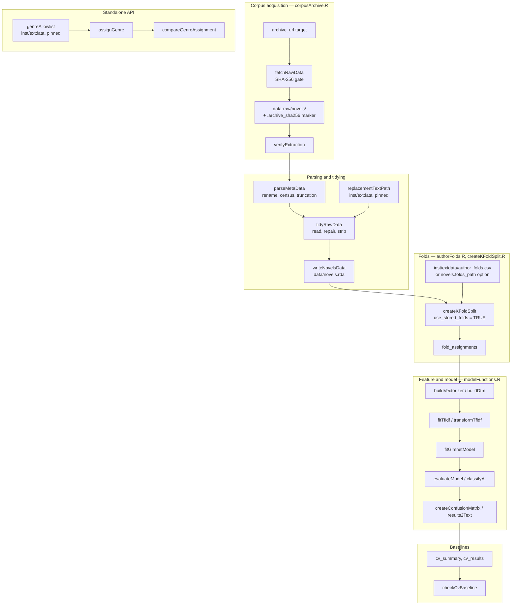

# Phase 4 — Final state: `novels`

**Date:** 2026-11-06
**Inputs:** `phase-1-discovery.md`, `phase-2-diagnosis.md`, `phase-3-plan.md`, the Phase 3
commit history (`c12e7f0..HEAD`), and the package check run in this phase.
**Scope:** 18 findings fixed, 1 new finding deferred, plus the deferred items listed at the end.

---

## 1. What the package looks like now

`novels` is still an R package whose job is to turn one pinned corpus archive into a tidied
dataset, then into cross-validated model results. The shape is unchanged; what changed is where
the seams are and whether the seams are verified.



### Module map

| File | Lines | Responsibility |
|---|---:|---|
| `R/corpusRepair.R` | 236 | LibriVox replacement snapshots, boilerplate stripping, title corrections |
| `R/modelFunctions.R` | 131 | DTM, TF-IDF, glmnet fit, evaluation, foldid |
| `R/tidyRawData.R` | 135 | Raw text → tidied `novels` tibble; writes `data/novels.rda` |
| `R/createKFoldSplit.R` | 121 | Author-safe split, stored-table resolution |
| `R/corpusArchive.R` | 119 | Download, digest verification, extraction marker |
| `R/compareGenreAssignment.R` | 97 | Genre calibration against Stonybrook labels |
| `R/parseMetaData.R` | 89 | Metadata parse, rename map, census |
| `R/checkCvBaseline.R` | 57 | Baseline comparison |
| `R/genreAllowlist.R` | 46 | Accessor for the shipped allow-list |
| `R/assignGenre.R` | 46 | Bookshelf → genre mapping |
| 17 smaller files | ≤ 40 each | split helpers, vectorizer wrappers, docs, internals |

The former 630-line `R/targetFunctions.R` no longer exists. No module exceeds 236 lines, and
each one covers a single pipeline concern.

### Working method

The verification story is what changed most:

- `make test` — fast loop, seconds.
- `make check` — regenerates Rd, builds the vignettes, then checks (6m50.8s measured;
  the pre-fix run took 36m59s under flags that also skipped building them).
- `make check-full` — regenerates Rd, then the release gate.
- `make data` — `targets::tar_make()`; the only producer of `data/novels.rda`.
- `.github/workflows/R-CMD-check.yaml` — builds the corpus from the pinned archive, runs the
  fast loop, then checks the package.

Before this phase the documented gate passed `document = FALSE` while `man/` was git-ignored,
so the Rd on disk could be stale; that is now mechanically impossible through the Makefile.

---

## 2. Before / after

| Area | Before | After |
|---|---|---|
| Test suite | **red**: 2 failures, 2 warnings, 99 passes | **green**: 0 failures, 0 warnings, 243 passes |
| Core-function tests | none for parsing, boilerplate, DTM/TF-IDF, glmnet, evaluation | characterization tests for all of them, plus regression tests per fix |
| Stored folds | silently bypassed under `tar_source()`; seed fallback | resolved option → installed package → source tree; missing table **errors** |
| Corpus provenance | 3 texts fetched live on every clean run | 3 texts shipped compressed in `inst/extdata/librivox_replacements/`, SHA-256 pinned |
| Extraction reuse | existing directory trusted blindly | `.archive_sha256` marker re-verified; missing marker warns; missing metadata errors |
| Code layout | one 630-line module (44% of R code) + dead code | five concern-specific modules, largest 236 lines; dead code and `httr2` gone |
| Fold logic | seed/sample duplicated in two functions | `makeFoldid()` delegates to `assignAuthorFolds()` |
| Genre API | exported but its input lived in git-ignored `tmp/` | `genreAllowlist()` + `inst/extdata/genre_allowlist.csv`, documented and tested |
| Packaging gate | `document = FALSE` against possibly stale Rd | `make check` regenerates Rd first; `Makefile` excluded from the build |
| CI | none | GitHub Actions: corpus build, fast loop, package check |
| Docs | 213 targets (real 216), wrong result-column provenance, a check duration that could not be reproduced | counts and provenance corrected, both measurements recorded, vignette scope stated |
| `_targets.R` packages | listed `usethis`, `assertthat` | only real dependencies |
| Tracked artifacts | `tests/testthat/_problems/`, `data-raw/novel_meta.csv` | both removed (history preserved) |

### Commit history

```
ecefb26 F15: add a minimal GitHub Actions check
5b41326 F8:  add a Makefile wrapper so checks regenerate Rd first
e0665c2 F6:  ship the genre allow-list and expose it as genreAllowlist()
5597b4f F4:  split targetFunctions.R by concern
eb71a0a F16: state that the glmnet vignette is not the pipeline
25af668 F7/F18: correct target counts, result provenance and check timings
30f3ed1 F9/F10/F11/F12/F13: remove dead code, unused deps and stale artifacts
5bcd28d F14: verify a reused corpus extraction against the archive pin
26201ee F5:  replace live Gutenberg fetches with pinned snapshots
f56320d F3:  characterize the untested data, feature and model code
d812290 F1:  resolve the stored fold table and fail loud when it is missing
52f73c8 F2:  repair fold-assignment tests
c12e7f0 Phase 3 baseline: pre-fix state
```

---

## 3. Health score

| Dimension | Before | After | What moved it |
|---|---:|---:|---|
| Data integrity & correctness | 8 | **9** | pinned replacement texts, verified extraction; residual: census not asserted (F19) |
| Reproducibility & determinism | 5 | **9** | stored folds actually used and fail-loud, no live fetches, extraction marker |
| Test coverage & test health | 4 | **8** | green suite, 99 → 243 passes, characterization tests for every core function; pipeline targets still not covered end-to-end |
| Code organization & cohesion | 5 | **8** | one 630-line module → five modules, largest 236; duplicate fold logic removed |
| Documentation accuracy | 6 | **8** | target counts, result provenance, check behaviour corrected; TODO/README still carry uncommitted user edits |
| Configuration & environment | 7 | **8** | hard-coded LAN address deleted with `embed.R`; `httr2` removed from `Imports` |
| Packaging & API hygiene | 5 | **8** | Makefile gate, CI, shipped allow-list accessor; `man/`/`data/` remain git-ignored by policy, now mitigated mechanically |
| Maintainability & extensibility | 5 | **8** | smaller modules, CI, dead code gone; the metaprogrammed `_targets.R` remains |
| **Overall** | **5.6** | **8.2** | verification and packaging gaps closed; the statistical design was already sound |

---

## 4. Remaining work

### New finding, still open

**F19 (LOW–MEDIUM) — the corpus census is recorded but never asserted.**
`parseMetaData()` returns `census$truncated` and `census$absent`; `tidyRawData()` then
`inner_join`s files to metadata, so a file with no metadata row disappears silently. The
file-conservation assert only catches the opposite direction. Today exactly one trailing record
is truncated (the known defect). Candidate fix: assert `length(census$truncated) == 1` and
log `absent` by id, so a future metadata change cannot quietly shrink the corpus.

### Deferred by decision

1. **`TODO.md` reconciliation is applied but uncommitted.** The stale baseline-comparison item
   was removed and a Done entry added, but the file also carries the user's in-progress rewrite.
   Commit it with that rewrite, not separately.
2. **`README.md` Zeitgeist bullet is uncommitted** (same reason: user's in-progress edit).
3. **The installed `novels` package is still 1.0.3.** Everything this phase added — `extdata`,
   `genreAllowlist()`, the split modules — is only visible after a release. Source-tree
   resolution keeps the pipeline working meanwhile.
4. **The level-3 gate's duration is unmeasured.** Level 2 was measured at 6m50.8s (after an
   earlier 36m59s reading that could not be reproduced), and level 3 differs only by
   re-building the vignette outputs, so it is expected to be roughly double. It was not run
   here.
5. **CI is unverified until the first push.** The YAML parses, and `tar_manifest(names =
   "novels_data")` confirms the corpus-only target, but no run has happened yet. Expect the two
   `inst/doc` WARNINGs by design; the job fails on errors only.
6. **No coverage measurement.** `covr` would say which branches of `tidyRawData()` and
   `corpusRepair()` the fixture tests actually reach. Not a defect, a missing instrument.
7. **`data-raw/oops.txt` is tracked but referenced by nothing.** It is a useful hand-written
   list of known corpus defects (LibriVox metadata, trailing boilerplate). It should be either
   linked from the corpus documentation or folded into `corpusRepair.R`'s comments.
8. **The genre API is not used by the pipeline.** `assignGenre()`/`compareGenreAssignment()`
   are now usable rather than scaffolding, but they remain a roadmap surface: genre labels in
   `novels` still come from Stonybrook metadata.
9. **`_targets.R` builds targets programmatically** (`as.symbol`/`bquote`) for the per-fold and
   per-alpha grids. It is correct and verified by `tar_manifest()`, but it is the least
   readable part of the project; a `tar_map()` rewrite is a separate, riskier piece of work.

### Things deliberately not changed

- `man/*.Rd` and `data/novels.rda` stay git-ignored. Committing generated files was rejected in
  favour of the Makefile wrapper, which forces regeneration at the point of use.
- The statistical design (author-safe folds, unigram TF-IDF, alpha sweep) was not touched. This
  phase changed how the pipeline is verified, not what it computes: `tar_manifest()` still
  reports 216 targets and the tidy dataset bytes are unchanged.

---

## 5. Gate result

```
$ make check
Rscript -e 'roxygen2::roxygenise()'
Rscript -e 'devtools::check(document = FALSE, args = c("--no-manual", "--no-build-vignettes"))'
...
Status: OK
Duration: 6m 50.8s
0 errors ✔ | 0 warnings ✔ | 0 notes ✔
```

## 6. What the gate actually covers

`R CMD build` knitted both vignettes (`glmnet.Rmd`, `novels-text-vectorization.Rmd`), so
`inst/doc` was populated and the two missing-`inst/doc` WARNINGs that the Phase 2 run saw did
not appear. The flag passed to `R CMD check` skipped only "checking re-building of vignette
outputs"; the vignettes' R code still ran (141s and 111s). The check therefore exercised the
whole package from an installed tarball: tests, examples, Rd, namespace, dependencies, and the
modelling code in the vignettes.

Two corrections to the Phase 2 record follow from this, and both are now in AGENTS.md:

1. **Level 2 can be a 0-warning run.** It cannot be 0-warning only when `build_args` also
   passes `--no-build-vignettes`, which withholds the built vignettes from the tarball.
2. **"37 minutes" is not a property of the task.** The same package checked in 6m50.8s a few
   hours later. The cause was not established (machine load or a package-install cache are the
   candidates), so the documentation gives the range and points at the run's own `Duration:`
   line instead of a single number.

The one `INFO` line ("installed size is 89.5Mb", 87.4Mb of it `data/`) is not a check note:
it is the expected consequence of shipping `data/novels.rda` in the tarball.
